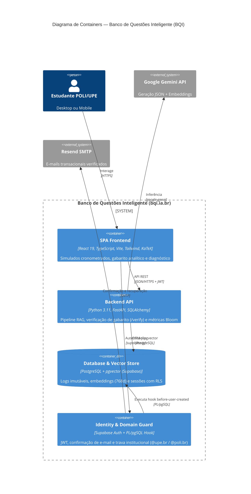
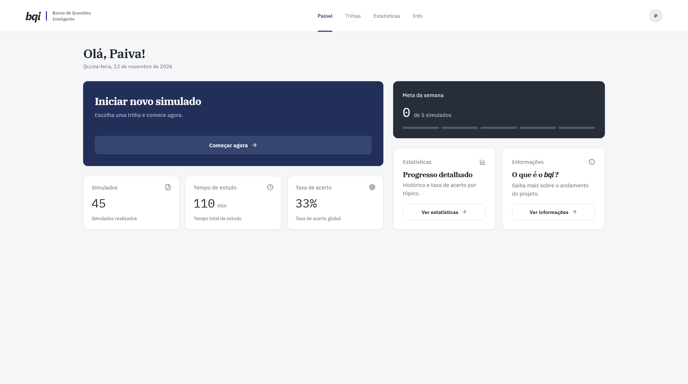
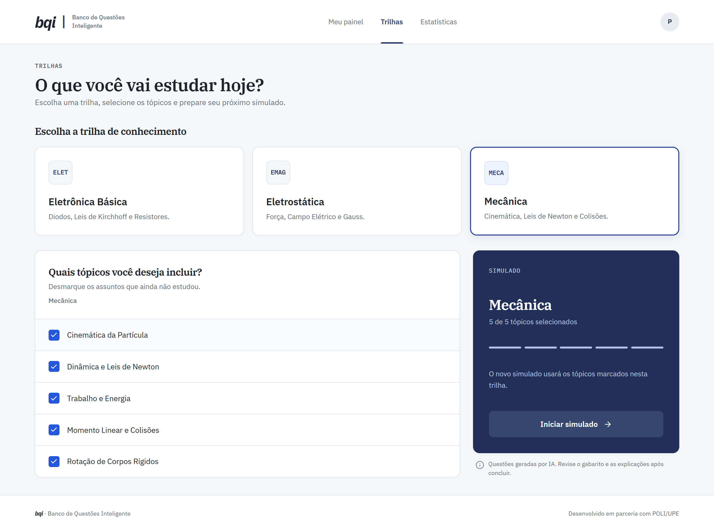
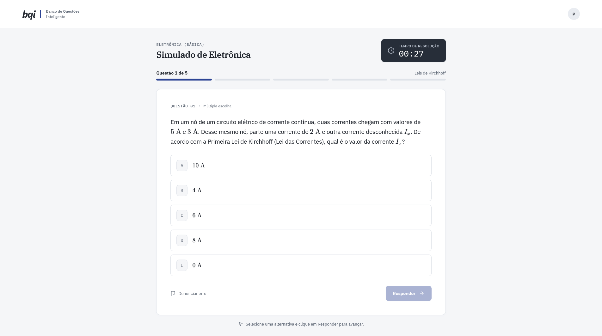
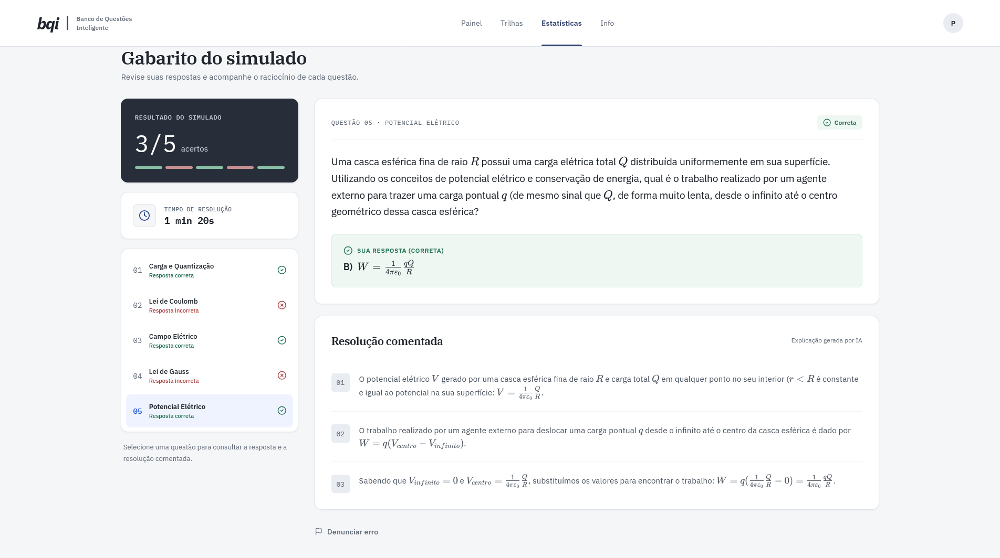
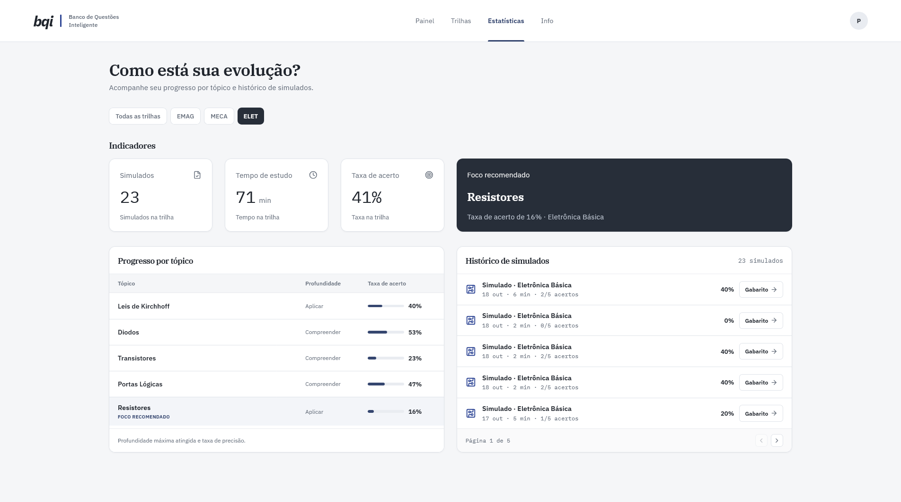
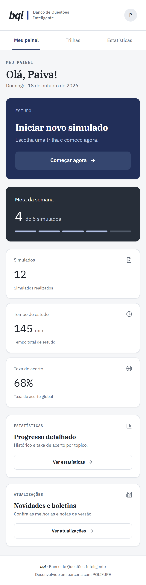
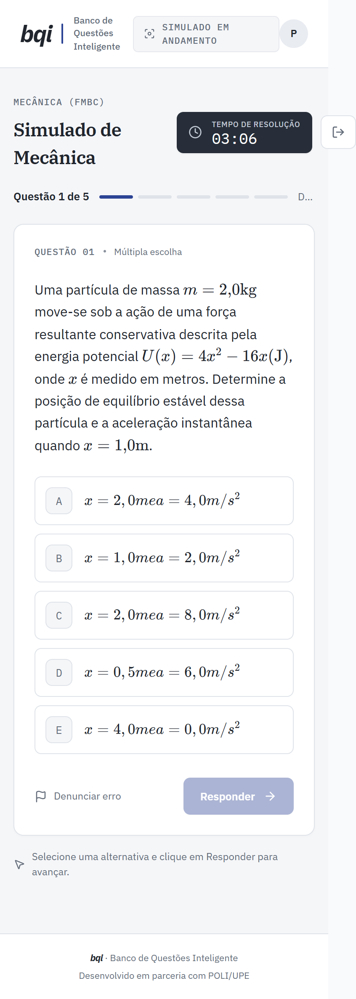
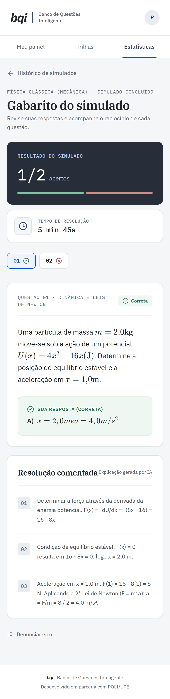
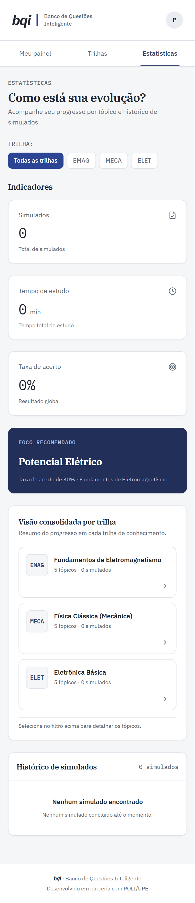

# bqi — Banco de Questões Inteligente (Architecture & Engineering Showcase)

[-1E293B?style=flat-square)](https://bqi.ia.br)

> **System Design & AI Engineering Case Study** do **Banco de Questões Inteligente (`bqi`)**, plataforma acadêmica em produção ([bqi.ia.br](https://bqi.ia.br)) desenvolvida na **Escola Politécnica de Pernambuco (POLI/UPE)** e apresentada como pesquisa de **1º autor na Mostra POLI/UPE 2026**.

> **Nota sobre código proprietário:** Como a plataforma está ativa em produção com acesso institucional restrito (`@upe.br` / `@poli.br`), o código-fonte completo de `frontend/` e `backend/` bem como os *System Prompts* e a base de questões permanecem em repositório privado. Este repositório reúne a arquitetura, diagramas C4/SDD, histórico evolutivo, capturas de tela e amostras isoladas de engenharia (`snippets/`).

---

## O Problema & A Solução

Estudantes de Engenharia enfrentam listas estáticas repetitivas e gabaritos sem dedução passo a passo, enquanto LLMs genéricos sofrem de três falhas graves em avaliações técnicas:
1. **Alucinação matemática:** inventar alternativas inconsistentes ao redigir o enunciado antes de resolver o problema;
2. **Quebra de JSON/LaTeX:** comandos como `\frac`, `\theta` ou `\beta` corrompem o parser JSON (`\f`, `\t`, `\b`) ou quebram a renderização no navegador;
3. **Deriva curricular:** questões fora do nível de exigência da disciplina ou sem alinhamento com a Taxonomia de Bloom.

O **BQI** resolve esses gargalos combinando geração estruturada por esquema Pydantic, **RAG Híbrido (`pgvector` + *Few-Shot Conceptual Shift*)**, **Protocolo `@@` + Sanitizador Determinístico KaTeX** e **isolamento *server-side* de gabarito**.

---

## Métricas Alcançadas em Produção

Dados reais coletados no ambiente de produção da POLI/UPE:

| Indicador | Marca em Produção | Detalhe |
| :--- | :---: | :--- |
| **Questões Técnicas Geradas** | **1.280+** | Questões inéditas parametrizadas e auditáveis em `questoes_geradas_log` |
| **Simulados Diagnósticos** | **210+** | Sessões cronometradas concluídas com histórico e telemetria por tópico |
| **Usuários Institucionais** | **110+** | Estudantes e docentes autenticados via e-mail `@upe.br` / `@poli.br` |
| **Trilhas de Engenharia** | **3** | *Eletrostática (FELM)*, *Mecânica Clássica (FMBC)* e *Eletrônica Básica (ELET)* |
| **Regressão LaTeX / KaTeX** | **60+ casos reais** | Falhas reais reportadas convertidas em suíte automatizada (`node --test`) |

---

## Stack Tecnológica

| Camada | Tecnologias | Responsabilidade |
| :--- | :--- | :--- |
| **Backend & IA** | Python 3.11, FastAPI, Pydantic v2, SQLAlchemy, `google-genai` | Orquestração RAG, esquemas estruturados, verificação de gabarito e métricas |
| **Banco & Vetores** | PostgreSQL (Supabase), `pgvector` (768d) | Armazenamento relacional, busca semântica vetorial e Row-Level Security |
| **Auth & Segurança** | Supabase Auth, Postgres Hooks (PL/pgSQL), Resend SMTP | Restrição de domínio em nível de banco, confirmação de e-mail e JWT |
| **Frontend & UI** | React 19, TypeScript, Vite 8, Tailwind CSS, KaTeX | Interface editorial responsiva, simulados, diagnósticos e renderização LaTeX |

---

## Destaques de Engenharia & System Design

### 1. Âncora Autorregressiva de Cálculo (*Structured CoT*)
O contrato Pydantic força o modelo Gemini a gerar os campos na ordem pedagógica e matemática correta antes de formular as opções ([ver schema](snippets/public_vs_internal_schemas.py)):
1. `raciocinio_interno` → define o nível da **Taxonomia de Bloom** e mapeia os erros conceituais típicos que formarão os distratores;
2. `resolucao_analitica_latex` → executa a dedução algébrica e numérica completa **antes** da criação do texto da questão;
3. `enunciado` & `alternativas` → redigidos a partir dos resultados já provados na etapa anterior.

### 2. Pipeline Híbrido de RAG (`pgvector` + *Few-Shot Conceptual Shift*)
- **Busca Semântica Vetorial:** trechos curriculares e ementas na tabela `rag_documents` são consultados via embeddings de **768 dimensões** no `pgvector`.
- **Injeção de Questão-Âncora (*Conceptual Shift*):** para o tópico selecionado (`topic_id`), o backend recupera uma questão real validada e instrui o modelo a aplicar mudança estrutural (geometria, malha de circuito ou grandeza isolada), evitando substituição numérica trivial.

### 3. Protocolo `@@` Anti-Alucinação + *Auto-Fixer* Grego para KaTeX
Para impedir que barras invertidas `\f`, `\t` ou `\b` corrompam o payload JSON do LLM:
- **No Backend:** o modelo emite tokens matemáticos com prefixo `@@` (`@@frac`, `@@theta`, `@@Omega`) e é proibido de escapar chaves `{` e `}` (*Brace Escaping Rule*).
- **No Frontend ([amostra do sanitizador](snippets/latex_sanitizer_sample.ts)):** o sanitizador converte `@@` → `\`, isola blocos `\text{...}`/`\mathrm{...}`, aplica *Auto-Fixer* por Regex *lookbehind* para letras gregas escritas sem barra (`sigma` → `\sigma`) e executa `balanceMathBraces` via pilha de profundidade antes de entregar ao **KaTeX**.

### 4. Segurança em Profundidade (*Defense-in-Depth*)
- **Anti-Cheat de Gabarito:** `/questions/generate` retorna apenas `QuestaoPublica` (sem `correta` e sem `resolucao_analitica_latex`); a verificação ocorre exclusivamente via `POST /api/v1/questions/verify`.
- **Bloqueio Institucional no Banco ([amostra SQL](snippets/auth_domain_hook.sql)):** validação client-side combinada com Postgres Auth Hook (`before-user-created`) que rejeita cadastros fora de `@upe.br`, `@poli.br` e subdomínios oficiais, além de exigência de `email_confirmed_at` no FastAPI.

---

## Visão Geral da Arquitetura (C4 Containers)

---

## Galeria da Plataforma (Produção)

### Desktop

| Painel do Estudante & Métricas | Seleção de Trilhas & Tópicos |
| :---: | :---: |
|  |  |

| Simulado Cronometrado (KaTeX) | Gabarito & Resolução Comentada por IA |
| :---: | :---: |
|  |  |

| Diagnóstico por Tópico & Taxonomia de Bloom |
| :---: |
|  |

### Mobile (Responsivo)

| Painel | Trilhas | Simulado | Gabarito | Estatísticas |
| :---: | :---: | :---: | :---: | :---: |
|  |  |  |  |  |

---

## Índice de Documentação Técnica

- **[ARCHITECTURE.md](ARCHITECTURE.md)** — Detalhamento da arquitetura, protocolo `@@`, RAG híbrido e segurança.
- **[CHANGELOG.md](CHANGELOG.md)** — Histórico evolutivo da plataforma (`v0.1.0` → `v1.0.0`).
- **Amostras de Código (`snippets/`):**
  - [Contratos Pydantic Anti-Cheat & CoT (`public_vs_internal_schemas.py`)](snippets/public_vs_internal_schemas.py)
  - [Auth Hook PL/pgSQL Institucional (`auth_domain_hook.sql`)](snippets/auth_domain_hook.sql)
  - [Sanitizador Determinístico LaTeX & Auto-Fixer (`latex_sanitizer_sample.ts`)](snippets/latex_sanitizer_sample.ts)
- **Especificações C4 & SDD (`docs/sdd/`):**
  - [Visão Arquitetural (`architecture.md`)](docs/sdd/architecture.md)
  - [C4 Nível 1 — Contexto (`c4-context.md`)](docs/sdd/c4-context.md)
  - [C4 Nível 2 — Containers (`c4-containers.md`)](docs/sdd/c4-containers.md)
  - [C4 Nível 3 — Componentes (`c4-components.md`)](docs/sdd/c4-components.md)
  - [Diagrama Entidade-Relacionamento (`erd-complete.md`)](docs/sdd/erd-complete.md)
  - [Máquinas de Estado (`state-machines.md`)](docs/sdd/state-machines.md)
  - [Domínio e Regras de Negócio (`domain.md`)](docs/sdd/domain.md)
  - [Dicionário de Dados & DTOs (`data-dictionary.md`)](docs/sdd/data-dictionary.md)
  - [Dependências & Tecnologias (`dependencies.md`)](docs/sdd/dependencies.md)

---

**Autor:** Pedro Paiva — Graduando em Engenharia Elétrica Eletrônica (POLI/UPE) · [bqi.ia.br](https://bqi.ia.br)
