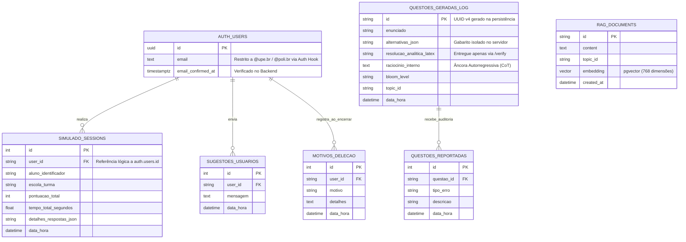

# Diagrama de Entidade-Relacionamento (ERD)

O diagrama abaixo representa as entidades principais persistidas no PostgreSQL (Supabase), com Row-Level Security (RLS) habilitado em todas as tabelas do schema `public`.

