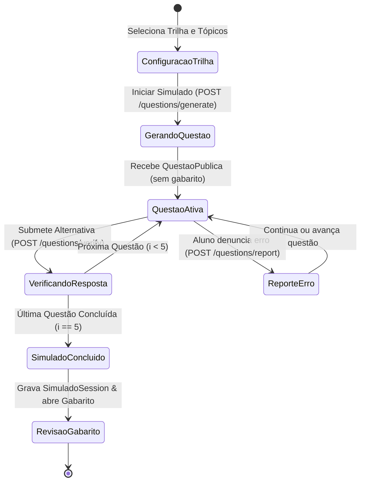
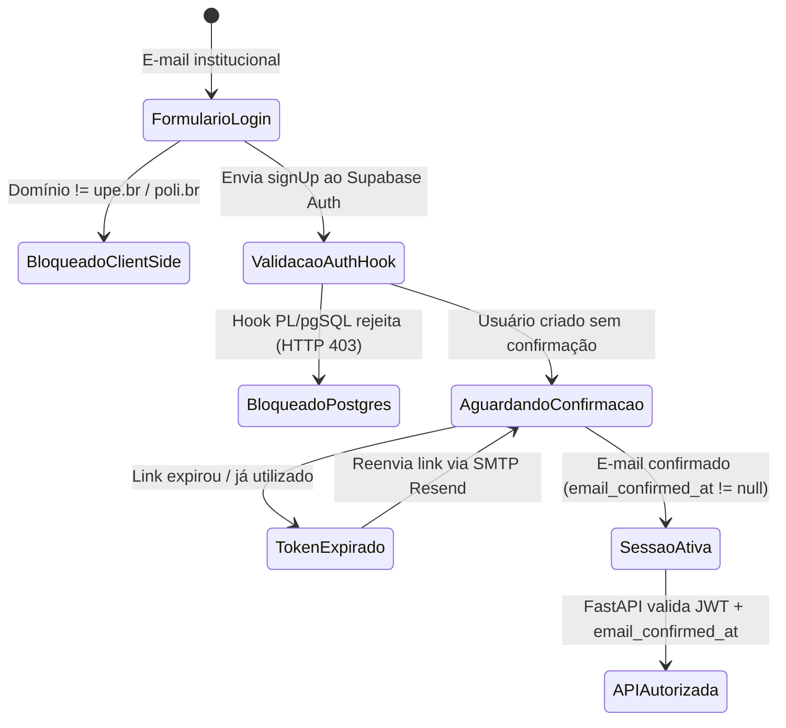

# Máquinas de Estado

## 1. Fluxo do Simulado Diagnóstico (Frontend + Verificação Server-Side)

O ciclo de uma sessão de simulado garante integridade pedagógica: o cliente recebe apenas as questões públicas (`QuestaoPublica`) e só desbloqueia a resolução comentada após a verificação no servidor (`POST /api/v1/questions/verify`).

---

## 2. Fluxo de Autenticação Institucional (Defense-in-Depth)

